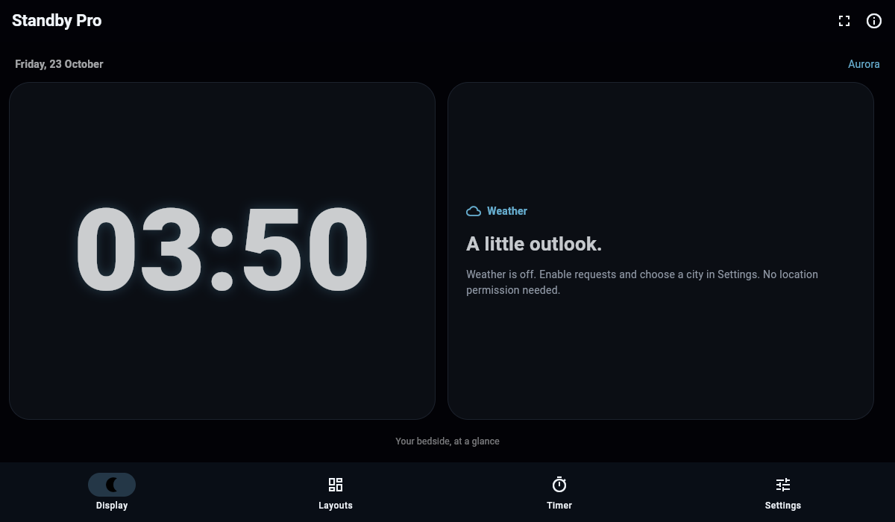

# Standby Pro

An independent, open-source Flutter bedside clock with four original faces and themes, Single/Duo layouts, optional city weather and a local visual focus timer.

**[Try the browser preview](https://ghostzy0.github.io/standby-pro/demo/) · [Setup guide](https://ghostzy0.github.io/standby-pro/guide.html) · [Releases](https://github.com/Ghostzy0/standby-pro/releases) · [Privacy](https://ghostzy0.github.io/standby-pro/privacy.html)**



Actual Flutter browser capture with fresh local settings, 1200×700. Browser preview evidence does not establish native phone behaviour.

## What you can do

- Choose Digital, Analog, Flip or Text clocks and Aurora, Night Red, Solar or Matrix themes.
- Use a single clock or two widgets, choose a preset in Layouts, and restore controls from Quiet display.
- Change 12/24-hour time, seconds, glow, brightness, scheduled night tint (20:00–07:00 local), and optional minute-level pixel shifts. System reduced-motion preferences disable pixel shifting.
- Run a 5/15/25/45 minute visual focus session, pause and reset. It has no sound, notification or background-alarm guarantee and resets when the app closes.
- Enable Open-Meteo weather for London, New York, Tokyo or Sydney. Requests are off by default; real provider temperatures, timestamps, loading and errors are shown. Refresh is manual or triggered by enable/city change.
- Keep local display settings, with defensive migration of the existing `standby_settings_v1` preferences.

## Know the limits

Calendar events are clearly labelled **samples**. Audio metadata is **unavailable** and playback is not started. No calendar, GPS, photo or notification permission is requested by this improved version. Android has INTERNET permission for optional weather.

Android can request screen-on and window brightness while the app is visible; the legacy persisted `keepAwakeWhileCharging` field now has an accurate foreground-only UI label. There is no charger detection or lock-screen/background service. iOS and web have app-local dimming; native keep-awake/brightness controls are unavailable. This app does not replace Apple's system StandBy or include a WidgetKit extension. Pixel shifting does not guarantee burn-in prevention or battery life.

This is a **source and browser-preview release**. No production signed APK/IPA is supplied. Physical Android/iPhone, TalkBack/VoiceOver, signing/update identity, charging/lock-screen, battery/thermal/OLED acceptance remain [tracked gaps](https://github.com/Ghostzy0/standby-pro/issues/4).

## Build and verify

Recorded toolchain: Flutter **3.41.9**, Dart **3.11.5**. [Dated build evidence](docs/evidence/native-hosted-builds-2026-10-24.md) records the tested hosts and native configurations. Preview.2 bundles the full app MIT notice in the licence screen; source CI passes44 tests, analysis and web compilation.

```sh
git clone https://github.com/Ghostzy0/standby-pro.git
cd standby-pro
git checkout v1.1.0-preview.2
cd app
flutter pub get --enforce-lockfile
flutter analyze
flutter test
flutter build web --release --base-href /standby-pro/demo/ --no-web-resources-cdn
```

For local serving, keep that base path or rebuild with `--base-href /`. Android additionally needs JDK17 and a compatible Android SDK/Gradle; configure release signing outside Git. The improved release configuration no longer falls back to debug signing. iOS needs macOS/Xcode/CocoaPods and signing for a physical phone. See [setup, installation, update and uninstall](https://ghostzy0.github.io/standby-pro/guide.html) and versioned [release notes](docs/releases/).

The [Flutter checks](https://github.com/Ghostzy0/standby-pro/actions/workflows/flutter.yml) workflow runs locked dependency resolution, analysis, tests and web compilation when app code changes. Maintainers can use **Run workflow** with `android-debug` or `ios-simulator` to check native compilation on a standard GitHub-hosted runner. These jobs publish no binary and establish no physical-device, accessibility or production-signing acceptance. The versioned preview above remains the recorded release.

Preferences retain their v1 key; invalid fields use safe defaults. Weather remains disabled when migrating old settings. Removing the app/site storage clears local preferences. A signing-identity change can require reinstalling and losing settings. Baseline and improved builds retain the same package ID and are alternative builds of one lineage.

AI setup prompt: “Clone Ghostzy0/standby-pro at v1.1.0-preview.2. Read CONTEXT.md and release notes, use Flutter3.41.9, run locked dependencies, analysis and tests. Report native signing/device gaps before building.”

## Preserved baseline and provenance

The existing repository, original history and community remain intact. [v1.0.0-baseline.1](https://github.com/Ghostzy0/standby-pro/releases/tag/v1.0.0-baseline.1) tags exact historical source9ce5e167. All10 existing tests and analysis passed on the current host before app changes.

A separate [standby-pro-baseline](https://github.com/Ghostzy0/standby-pro-baseline) repository preserves all83 original app files with SHA256 provenance. Its baseline.2 packaging patch restores original ignored Gradle wrapper files; no app redesign is mixed into that baseline. Historical third-party listing captures remain in old Git but are excluded from the current distribution. [Fidelity boundaries](docs/releases/provenance-and-fidelity.md) explain why no faithful third-party replica is claimed.

## Project and evidence

- `app/lib/src/`: settings/domain, controller/services, clock policies, display and focus timer.
- `app/test/`: migration, persistence failure, async races/disposal, weather validation, navigation/compact/landscape/large-text regressions.
- `app/tool/capture_test.dart`: explicit synthetic screenshot harness with real SDK Roboto fonts; run with STANDBY_FLUTTER_ROOT set and `flutter test tool/capture_test.dart --update-goldens`.
- [PLAN.md](PLAN.md), [CONTEXT.md](CONTEXT.md), [CHANGELOG.md](CHANGELOG.md), [FUTURE-IDEAS.md](FUTURE-IDEAS.md).
- [Independent assisted audits](docs/audits/), [runtime/build evidence](docs/evidence/), [platform research](docs/research/platform-and-product.md).

## Privacy, dependencies and licence

No account, ads, payments or analytics. Preferences stay on device. Optional weather exposes IP and selected public-city coordinates to Open-Meteo. Weather data: **Open-Meteo, CC BY4.0**; its free endpoint is **noncommercial** under [provider terms](https://open-meteo.com/en/terms). Monetised distribution needs suitable service rights; no paid fallback is configured.

Original source is [MIT](LICENSE). Resolved dependency licences are in [THIRD-PARTY-NOTICES.txt](THIRD-PARTY-NOTICES.txt) and the app licence screen; [inventory](docs/dependencies.md). No competitor artwork is bundled. Read [contributing](CONTRIBUTING.md) and [security reporting](SECURITY.md).
